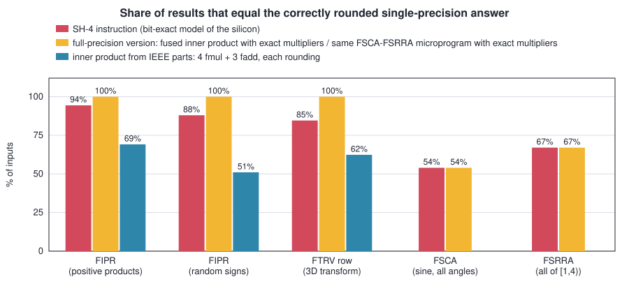
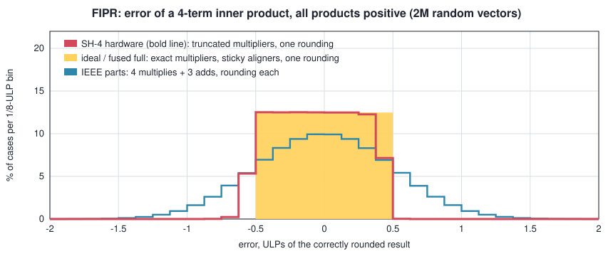
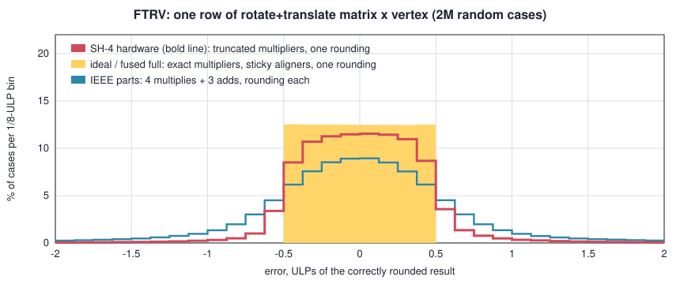
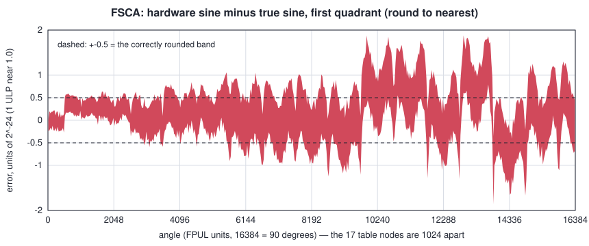
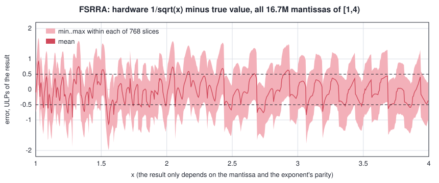
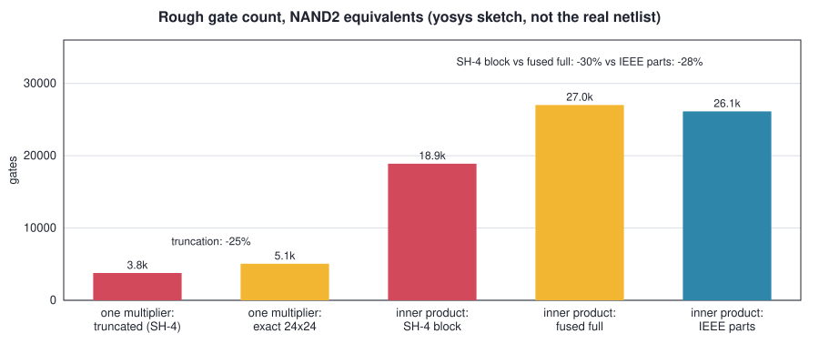
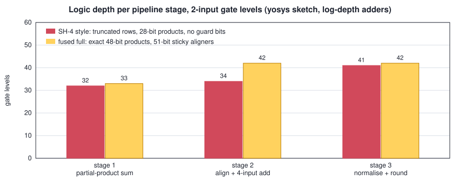

# Bit-exact at last: the SH-4's "approximate" 3D instructions, reverse-engineered by a human and three kinds of AI agents

*shrike4 notes — FIPR, FTRV, FSCA and FSRRA of the Dreamcast's Hitachi SH7091, recovered down to the last bit, flag and trap.*

## Summary

The SH-4 in the Dreamcast has four floating-point instructions that exist purely for 3D geometry: **FIPR** (4-element
inner product), **FTRV** (4x4 matrix times vector), **FSCA** (sine and cosine of a 16-bit angle) and **FSRRA**
(reciprocal square root). The manual calls their results approximate and leaves it there. Every emulator and every FPGA
core has therefore been guessing: compute the mathematically nice answer, or copy a table dumped from a console.

We now have **bit-exact models of all four**, derived from how the silicon actually computes rather than fitted to it,
and verified against a real Dreamcast:

| instruction | verified against hardware | mismatches |
|---|---|---|
| FIPR | 32M vectors + 5.2M edge vectors (DN = 1), 1M denormal-range vectors (DN = 0), each in round-to-nearest and round-to-zero | 0 |
| FTRV | 524,288 matrices x 4 rows, both rounding modes | 0 |
| FSCA | all 65,536 angles, sine and cosine, both rounding modes | 0 |
| FSRRA | all 16,777,216 mantissas of [1,4) in both modes, and all 2,130,706,432 positive normal inputs in round-to-nearest | 0 |
| FPSCR behaviour of all four (cause / flag bits, traps, DN, PR) | 3,114 measured cases | 0 |

The deliverables are single-header C99 references (`sh4_fipr.h`, `sh4_fsca.h`, `sh4_fsrra.h`, and the combined
`sh4_fpu_approx.h`), a SystemVerilog implementation of all of it on **one shared datapath** with the measured cycle-level
latencies, and the test programs that ran on the console.

The short version of what the hardware is: **one block of four truncated Booth multipliers, four aligners, a four-input
adder and a single rounding stage.** FIPR uses it once. FTRV uses it four times. FSCA and FSRRA are tiny microprograms
that push a piecewise cubic through the same multipliers, feeding product registers back as operands, with a 17-word and
a 34-word coefficient ROM. Nothing else. No CORDIC, no divider, no iteration.

The effort took about **four days**, roughly **80M tokens** of model compute, about **two days of machine time** in
fits, exhaustive scans and simulations, and about **48 hours of human involvement**. Three model families worked on it
— Claude Fable 5.1, Claude Opus 5 (including swarms of up to 20 parallel sub-agents) and GPT Astra (logged as
`gpt-6-astra`) — and, as the timeline below shows, the decisive turns came from the human in the loop and from agents
reading each other's handover notes.

### How "approximate" are they? Less than you would think — and in one case better than IEEE

All numbers below come from the bit-exact model (so they are the console's numbers), compared with the exact
mathematical result. "Correctly rounded" means the instruction returned the same float an infinitely precise
computation rounded once would return. Each instruction is shown next to two alternatives a designer could have built:

* a **full-precision version of the same design** — for FIPR / FTRV a *fused* inner product with four exact 48-bit
  products, aligners that keep a sticky bit, one adder and one rounding; for FSCA / FSRRA the very same microprogram and
  ROM with exact multipliers instead of the truncated ones;
* for the inner products, the same arithmetic built from **IEEE parts**: four multiplies and three additions, each
  rounding its own result.



**FIPR and FTRV are *more* accurate than doing the same arithmetic with IEEE multiplies and adds.** A program that
computes `a0*b0 + a1*b1 + a2*b2 + a3*b3` with ordinary `float` operations rounds seven times; the SH-4 block keeps 28-bit
products, adds them exactly and rounds **once**. For well-conditioned inner products the hardware is correctly rounded
in 94 % of cases with a worst case of 0.89 ULP; the IEEE sequence manages 69 % and 2.04 ULP. The fused full-precision
design is, as it must be, correctly rounded every time (green: a flat distribution inside +-0.5 ULP) — so the six points
the SH-4 gives up are the whole price of cutting the multiplier arrays and dropping the aligners' guard bits, and it still
lands well inside one ULP.



The flip side, for emulator authors: the hardware result **differs in its bit pattern from the naive float computation
in 31-48 % of inner products** (36 % for a typical rotate-and-translate matrix row). Exact emulation of games that
compare, hash or replay geometry needs the real thing.



**FSCA** is a cubic around 17 table nodes per quarter turn, evaluated on a 2^-26 grid. Its error never exceeds 1.88
units of 2^-24, and 54 % of all angles are correctly rounded. The plot shows the signature of the design: small errors
where the sine is small (the result has more bits than the internal grid there), a ripple with the period of the table
nodes, and a few nodes whose stored constants are biased by two or three units — a property of how Hitachi generated the
ROM, which is still an open question.



**FSRRA** stays below 2 ULP everywhere (worst case 1.99), with 67 % of inputs correctly rounded — for an instruction
that takes 6 cycles where a square root followed by a division takes 23.

For these two the truncated multipliers cost **nothing**: running the same microprogram and ROM with exact multipliers
gives 53.95 % against the silicon's 53.98 % for FSCA and 67.03 % against 67.04 % for FSRRA, with identical worst cases.
Their accuracy is set by the cubic and its table, not by the arithmetic — which is exactly why reusing the cheap array
for them was a good idea.



A few behaviours the manual does not mention, all measured on the console:

* Every finite result of all four instructions raises the *inexact* cause and flag, even `1.0 * 1.0`; any zero result of
  FIPR/FTRV also raises *underflow*, even `0 * 0`.
* Setting the inexact-enable bit makes FSCA and FSRRA trap for **every** operand. FIPR traps unconditionally on any of
  the overflow / underflow / inexact enables, FTRV additionally on the invalid enable.
* With `FPSCR.PR = 1` all four instructions are complete no-ops (registers and status untouched) — but they still trap
  if the right enable bit is set.
* With `FPSCR.DN = 0`, FIPR and FTRV do **not** raise an FPU error on denormals: they compute with them and return
  denormal results. FSRRA, on the same chip, does trap on a positive denormal.
* FTRV Booth-recodes the **matrix** element; FIPR recodes its second operand. Swap the roles and 51,000 of 2.1M rows
  come out wrong.
* Two infinities of the same sign in one inner product take the sign of *product 0*, whatever product 0 is.
  `-inf - inf` can be `+inf`.

## The 3D unit in one page

Geometry on a 1998 console is dominated by two operations: transform a vertex by a 4x4 matrix, and normalise or light it
(dot products, reciprocal square roots, the occasional sine). Hitachi's answer (US patent 6,038,582) was to spend the
FPU's area on one wide, shallow block instead of a faster general multiplier:

```
   four 24 x 24 truncated Booth multipliers      -> four 28-bit product registers  (+2^19, drop 20 bits)
   four aligners (shift to the largest exponent, invert if negative: no guard bits, plain truncation)
   one four-input adder
   one normalise / round stage                   -> the only rounding in the whole instruction
```

The multipliers are where the "approximation" lives. Each is a radix-4 Booth array of 13 partial-product rows, and every
row is simply **cut off below column 16** of the 48-bit product. A negative row is a one's complement whose "+1" is only
added when it lands at column 18 or above; two small groups of rows keep or lose one carry bit at the cut. A constant
2^19 re-centres the truncation error. That is the entire list of quirks, and every one of them is visible in the data.

**FIPR** runs the block once: 4 cycles latency, a new one can start every cycle. **FTRV** runs it four times (7 cycles,
one every 4). The clever part is the other two instructions. They reuse the same multipliers as a microprogrammed
polynomial evaluator, with product registers fed back (shifted right by three) into multiplier inputs:

```
   FSRRA (3 multiply steps, 6 cycles)      node = rounded top 5 bits of the mantissa, dx = the signed remainder
     step 1   dx * dx -> sq                dx * REC1 -> linear term
     step 2   sq * C2 -> square term       sq * C3   -> I
     step 3   I  * dx -> cubic term        adder: C0 - linear + square - cubic, round once

   FSCA  (4 steps; sine after 3, cosine one cycle later reusing the held latches)
     step 1   dx * dx            dx * L[cos word]        dx * KC               (KC ~ 4 pi, one global constant)
     step 2   sq * dx -> cube    (KC dx) * dx -> J
     step 3   cube * Q[cos word] J * L[sin word]         adder: C0 + linear - even - cubic
```

The ROMs are tiny: **17 words of 63 bits for FSCA** (1,071 bits; each word holds values derived from one `sin(m pi/32)`,
and a single instruction reads word `r` and word `16 - r` and uses every field of both) and **34 words of 75 bits for
FSRRA** (2,550 bits). The detail that kept FSCA unsolved for a day and a half is in that table: there is no separate
"sine" coefficient for the even term — the hardware reuses the *linear* coefficient of the other word, and folds the
missing factor into the global constant.

### What does the truncation buy?

We do not have the real netlist, so this is an estimate from a quick gate-level sketch: every variant written the same
way (13 Booth rows, one's-complement negative rows plus hot ones) and pushed through yosys; see `tools/gen_area.py`.
Exponent logic is included, special operands and flags are not.



| | rough gate count (NAND2-equivalents) | correctly rounded (positive products) | worst error |
|---|---|---|---|
| exact 24 x 24 Booth multiplier | ~5,100 | | |
| the same array cut below column 16, 28-bit product | ~3,800 (**-25 %**) | | |
| **SH-4 style block**: 4 truncated multipliers, 4 truncating aligners, one 33-bit adder, one rounder | **~18,900** | 94 % | 0.89 ULP |
| **fused full** inner product: 4 exact multipliers, 4 aligners with a 51-bit window and sticky bit, one 55-bit adder, one rounder | ~27,000 | 100 % | 0.50 ULP |
| inner product from **IEEE parts**: 4 multiply + round, 3 full floating-point adders | ~26,100 | 69 % | 2.04 ULP |

So the SH-4 block is about **30 % smaller than the correctly rounded fused design** (and 28 % smaller than the IEEE
composition, which costs as much as the fused design while being far less accurate). About 5,000 of the
8,000 gates saved are in the four multipliers; the rest comes from everything behind them: 28-bit instead of 48-bit
products mean the aligners, the four-input adder, the leading-zero counter and the normalising shifter are all some 20
bits narrower. Beyond the gate count:

* **Latency.** One rounding stage instead of seven, and four multiplies in parallel: FIPR takes 4 cycles where a dependent
  chain of FMULs and FADDs on the same chip (3 cycles each) needs about 12.
* **FSCA and FSRRA are almost free.** They add ~3.6 kbit of ROM, a few feedback multiplexers and a sequencer to a block
  that had to exist anyway, and — see above — lose no accuracy to the truncation. Measured on the console: FSRRA 6 cycles
  against FSQRT (11) + FDIV (12); a sine *and* a cosine in 7 cycles.
* The trade is visible only in the last six percent of inner products, and never by as much as one ULP.

### Area, or speed?

A fair question: maybe the rows were cut to make the multiplier *faster* rather than smaller. We cannot know the designers'
intent, but three pieces of evidence point at area:



| pipeline stage (2-input gate levels, same sketch, log-depth adders) | SH-4 style | fused full |
|---|---|---|
| 1. partial-product sum of one multiplier + final carry-propagate add | 32 | 33 |
| 2. four aligners + four-input adder | 34 | 42 |
| 3. sign-magnitude, leading-zero count, normalise, round | 41 | 42 |

* **Cutting rows short removes no adder-tree level.** The depth of a Booth multiplier's reduction tree is set by the
  *number* of partial-product rows, and there are 13 of them either way. Truncation only shortens the final
  carry-propagate add from 48 to 32 bits — one gate level with a parallel-prefix adder.
* **An exact product demonstrably fits the clock.** FMUL on the same chip is IEEE-exact and has the same measured 3-cycle
  latency as FADD, so an exact 24 x 24 multiply already meets timing at 200 MHz.
* Where width does matter is stage 2 (34 against 42 levels: 28-bit aligners and a 33-bit adder instead of a 51-bit sticky
  shifter and a 55-bit adder), but in this sketch the longest stage of **both** designs is the normalise-and-round stage at
  41-42 levels, so the clock would not change.

The patent agrees in spirit: its stated motives are "circuit scale" and latency, both argued for the *single shared
normalise/round stage* ("the circuit for normalization, obtaining positive number and rounding may have equivalent
circuit scale as that of the multiply-add unit") — and it never mentions cutting the multiplier arrays at all; that
detail exists only in the silicon. So our reading is: **the truncation is an area optimisation** — four multipliers at
three-quarters of the price, narrower registers, feedback paths and wiring behind them — with at most a modest timing
benefit in the align-and-add stage. The usual caveat applies with force here: generic gates and our own RTL sketch say
little about the wire-dominated delays of a 1997 full-custom datapath, where a 51-bit barrel shifter and a 55-bit adder
cost more than their gate depth suggests.

## Timeline

Timestamps are UTC, from the agents' session logs. Quotes from the human (skmp) are verbatim.

### Prehistory
An 8.5 GB dump of FSRRA over every positive float, captured from a Dreamcast years ago, and a 32,768-entry FSCA table
inside the emulator. Good enough to emulate by lookup; no explanation of where the numbers come from.

### Day 1, 00:58 — "can you write a c++ model for the fsrra instruction, that matches bit for bit" (Claude Fable 5.1)
Within hours: the result depends only on the mantissa and the exponent's parity; 17 nodes per parity; a cubic; products
truncated separately; round to nearest on two guard bits. Fitted coefficients reach 99.63 %. Every miss is exactly one
ULP. A fit, not an explanation.

### 07:13 — the question that set the direction
> "could this re-use the same multiplies used for fipr internally -on top of the table-? fipr is a*b+c*d+e*f+g*h"

This one sentence is the architecture. It took a day and a half to prove it.

### 09:27-11:00 — FIPR first, and integer-only
A first hardware test (a KallistiOS program, run by the human over the network on a real console) showed the manual's
FIPR pseudo-code is wrong in places. Then, with no more console time that day:
> "can you analuze fipr further? I think it holds the key to this"

and, after a false start with Python floats:
> "let's take a step back. Let's characterize fipr first, and use c++ and soft fp / bit math, not python / native floats
> to make sure we get this right. I think a dump of 64 M or so of fipr vectors is in order, first?"

That became a standing rule — *decide every hypothesis in integer arithmetic* — and it paid off the same day: 32M
vectors, **0 mismatches**, and the truncated Booth array (rows cut below column 16, hot ones from column 18, two group
carries) as the first fully understood piece of silicon.

### 11:00-17:00 — FSCA resists
Fitted constants, per-node corrections, piecewise-linear tables, Taylor series, exotic separate units. The model got
closer and less believable. The human pulled it back twice:
> "my goal for now is understanding how the hardware worked, not a similar-but patched implementation. i think we're
> getting something fundementally weong"

> "can you write a harness to measure the latency and pitch of instructions from the hw? it is running. i do not trust
> the sim."

The timing harness gave hard numbers — FIPR latency 4, FSRRA 6, FSCA one every 4 with the cosine a cycle after the sine
— which later fixed the number of multiply steps each microprogram may use.

In parallel the human handed the written state (`CURRENT.md`) to a **GPT Astra** session, which found two things the
first agent had missed — the linear coefficient is rounded to 23 significant bits, and the decoder that turns a float
pair into an interval mishandled ties, hiding 21,628 exact internal values — and the human pasted them back. From here
on the agents worked through shared handover documents rather than shared context.

### 17:05 — "can you scan the internet and download all related patents"
US 6,038,582 shows the block: four multipliers, aligners, a four-input adder, feedback paths. With the FIPR array
plugged into the FSCA terms **with zero free parameters**, whole-dump mismatches dropped from 490 to 176; FSRRA went from
0.345 % to 0.021 % once its cubic was evaluated coefficient-first through a feedback latch. Structure was finally
beating fitting. What remained was small and stubborn: 147 of 32,768 FSCA samples, all in the even (cosine-like) term.

### Day 1 19:06 -> Day 2 10:14 — the Opus 5 swarm
A fresh **Claude Opus 5** session was told to re-validate everything and try for a breakthrough. It ran four
multi-agent workflows — **38 Opus 5 sub-agents** in total, up to 20 at once, each family of hypotheses paired with an
adversarial verifier. It localised the whole residual to one node-independent latch ("J"), wrote exact solvers that
killed entire families outright (every two-multiply chain tops out at 938-944 of 1024 offsets), validated the multiplier
model on the console in FSCA's own operand range (31,104 vectors, 0 mismatches), and followed several human suggestions
to their end: treat it as a black-box optimisation problem, vary the width and rounding of the offset, and
> "can you use 'backwards differential analysis' and/or 'symbolic back propagation' from the pairs that one ronding mode
> is correct and the other isn't"

which produced a 67-offset "hard core" that any candidate must explain first. GPT Astra contributed a reframing the
human relayed: *"change the question from 'what correction produces J?' to 'which hardware assumption makes J look
wrong?'"* — exactly right, as it turned out, and nobody could yet say which assumption.

The swarm's conclusion — "the missing quantity must be a stored value" — was rigorous but conditional on a model that
still contained the wrong assumption. Score: still 147.

### Day 2 10:15 — "something structuraly wrong… some 'bithack'" (Claude Fable 5.1)
The human's brief for the next session:
> "FSCA, FSRRA and FIPR are very likely to share the same pipeline, just enhanced. Can you implement FIPR, FSCA, FSRRA as
> modular system verilog, and then based on that try to identify what simplifications or structural differences could
> lead to a model that matches"

Writing the three instructions as RTL on one datapath forced every term into "a product register, shifted, into a
latch", reproduced FIPR exactly including its latency, and turned the models' sign conventions into one hardware rule
(every negative adder input gets a hot one). Then seven passes of structural tests, each prompted by a human objection —
non-power-of-two ROMs, the cost of signed multipliers, ROMs of different sizes per term, *"we have designed a different
architecture that gets very close"*, even *"how certain are you this is indeed a polynomial"* with a three-shear
rotation as the alternative. Useful model-free facts came out (the hardware's `sin(-1 step)` is not `-sin(+1 step)`: the
multiplier really sees a two's-complement offset), along with several of the agent's own retractions. Every structure
landed on the same floor of 123-160 violations.

### 13:21 — the redirect
> "so this looks like a dead end, for now. would investigating further the fsrra path (to either find a common structure,
> or discover a new structure it may be using that may be also used by the cosine) make sense?"

It did. FSRRA has 512 times more data per node than FSCA and no sign asymmetry. After fixing three wrong table entries,
its residual showed a **clean scaling law**: the error grew as 2^k with the model's normalisation exponent and vanished
where the exponent was smallest. That names the mistake — the silicon never normalises that coefficient; it is a plain
14-bit fixed-point field. Fixing it exposed a second error it had been hiding (the cubic chain reads the same square
latch as the square term), and FSRRA went **exact on 16.7M inputs in both rounding modes**, then on all 2.13 billion
inputs of the old 8.5 GB dump (which turned out to contain three zero-filled stretches and one flipped bit).

The port of FSRRA's structure to FSCA failed. So everything known — proven primitives, dead families, corrections to
earlier claims, *ideas not yet tried* — went into a handover written explicitly for other agents, with one command that
re-measures every number in it.

### 15:21 -> 15:26 — five minutes (GPT Astra)
The human pointed a GPT Astra session at that handover: *"Make breakthrough progress, by combining all previous results
and new knoewledge from frssa structure."* Its log reads:

* 15:21 — baseline reproduces; *"One gap remains in the handover: forming the even term from parallel products of ROM
  fields and the signed offset, with both feedback latches shifted by three."*
* 15:25 — *"reusing the complementary word's **linear coefficient** in place of the assumed sine field lowers one
  candidate to 86 violations."*
* 15:26 — *"zero sine or cosine mismatches across all 65,536 angles in RN and RZ."*

The field everyone had modelled — a stored sine for the even term — does not exist. The ROM's linear coefficient
(sin * pi/2) is reused, the global constant is an economised 4 pi instead of 2 pi^2, and the latches follow FSRRA's
shift-by-three discipline. The earlier notes even contained the tell: that "sine field" was the one coefficient the data
barely pinned. A weakly pinned field is a candidate for not existing.

Fable 5.1 then re-derived the claim from its four lines with independent code against the raw capture (0 mismatches;
the constant +-1 gives 46-78), re-ran the RTL from a clean build (0 mismatches, latencies unchanged) and checked that no test
had been loosened.

### Day 2 evening — flags, traps and the console again
> "can you characterize the hardware, by writting a test for that and running it on <console-ip>"

Six small programs with an exception handler that records a trap and skips the instruction measured everything the
captures never covered: special operands, every FPSCR setting, PR = 1, DN = 0, FTRV. That is where the surprises in the
summary came from, and where FIPR's denormal arithmetic (1M vectors, exact at the first natural hypothesis) and FTRV's
operand roles were pinned. The single-header references and the combined `sh4_fpu_approx.h` (generated from the three so
it cannot drift) closed the day.

## The human in the loop

Going through the logs, the inputs that changed the outcome were few and specific:

1. **The architectural prior** — "re-use the same multiplies used for fipr". Right from the first morning.
2. **Method** — characterise FIPR first; integer / soft-float only; "I do not trust the sim" (measure timing on hardware);
   fetch the patents.
3. **Refusing the patched model** — "understanding how the hardware worked, not a similar-but patched implementation".
   Without this the project would have shipped a 99.7 % table-and-fudge model on day one.
4. **Hardware operator** — every capture ran on a physical console the human kept alive, reset and re-addressed
   ("sorry i got the ip wrong, it is .95"), plus domain knowledge no log contains ("the stalls were icache fills").
5. **Relay between models** — pasting one agent's findings into another's session, and asking for handover documents at
   every stop. The final breakthrough was a different model family reading a handover and testing its "not yet tried"
   list.
6. **Knowing when to leave** — "this looks like a dead end, for now" redirected the effort to FSRRA, which cracked within
   hours and made FSCA fall the same afternoon.

What the agents contributed was volume and rigour: roughly a thousand throwaway source files (38,000 lines of C and C++
analysis tools), exhaustive scans over millions of structures, exact solvers, adversarial verification, in-place retraction of
their own wrong claims — and the stamina to try the 657,800th configuration.

## What is still open

* How Hitachi **generated the ROM constants**. Every field is known to the last bit; several are biased by a few units
  against any clean rule we tried. A nice closed puzzle.
* The RTL computes values and timing; the measured flag and trap behaviour is in the C references but not yet in the RTL.

## Reproducing

Everything lives in `shrike4-rtl/`: `model/verify_all.sh` re-measures every number above from the captures in about a
minute; `model/sh4_fpu_approx.h` is the header to take away; `model/*/hw_specials/` hold the console programs;
`blog/fpu/tools/` holds the precision (`precision.cpp`, `make_plots.py`), area (`gen_area.py --run`, about 8 minutes of
yosys) and logic-depth (`gen_depth.py`) scripts behind this post's plots and estimates.
